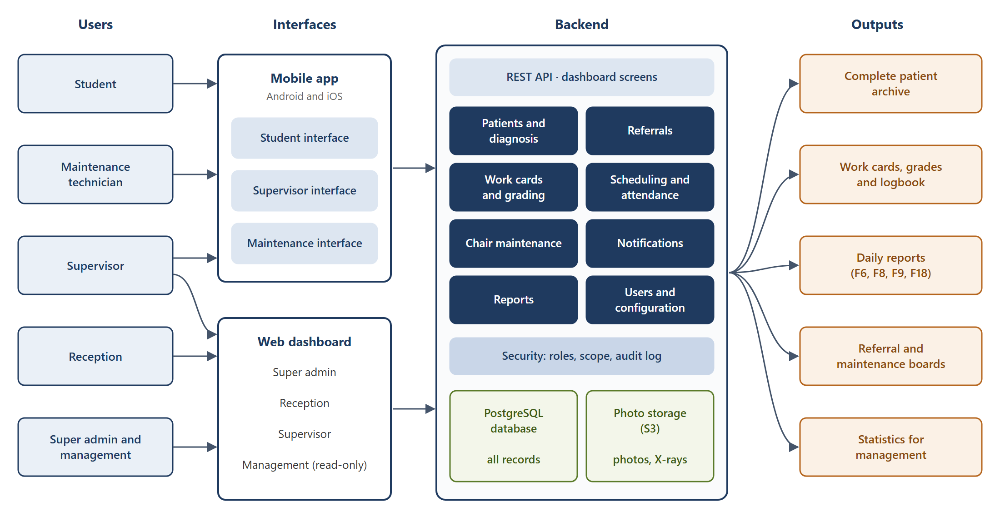
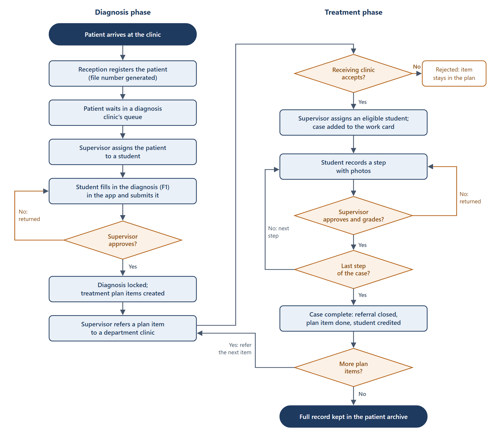

# SPU Dental Clinic System — Graduation Project Report, Part 1

Oct 29, 2026 · @Hamza

## Abstract

The clinics and laboratories of the Faculty of Dentistry at Syrian Private University (SPU) run on paper. Diagnoses, referrals, students' work cards, supervisors' signatures, chair schedules and chair maintenance are all recorded on printed forms. There is no central patient archive, so a patient's treatment plan is often lost after the first visit, and the faculty cannot easily follow students' progress or the use of its clinics. This project builds the SPU Dental Clinic System: a mobile app for students, supervisors and maintenance technicians, a web dashboard for administration, reception, supervisors and management, and one backend that enforces the faculty's clinical and teaching rules. This first part of the report states the problem and the objectives, reviews published studies and existing systems, presents the proposed solution with a block diagram and a flowchart, and gives the theoretical study that the project is built on.

## 1. The Scientific Problem

### 1.1 Background

Dental education is largely clinical. In their clinical years, students treat real patients under the supervision of faculty members. Each patient is diagnosed, receives a treatment plan, and is treated in a specialty clinic. Each treatment step a student performs must be checked, graded and signed by a supervisor before it counts toward the student's course requirements.

At SPU, this process is recorded on the faculty's quality forms (SPU/AQM M-09-Den-F1 to F18). The team studied eight of these forms and visited the clinics on 18 October 2026:

| Form | Purpose |
| --- | --- |
| F1 | Patient diagnosis: personal data, medical history, dental chart (FDI notation), soft tissue examination, oral hygiene indices, X-ray findings, diagnosis and treatment plan |
| F2 | Lab course work card: the student's lab cases and the steps of each, signed by a supervisor |
| F3 | Clinical course work card: the student's clinical cases (patient, tooth, case type) and up to eight graded steps for each |
| F6, F18 | Daily chair checks (cleanliness, handpiece connections, chair movements, lighting), morning and afternoon |
| F7 | Distribution of students to chairs across the five daily sessions |
| F8, F9 | Daily clinic and laboratory reports |

### 1.2 Problem statement

The paper process causes problems for patients, students, supervisors and the faculty's management:

1. **No patient archive.** Paper files are not linked or indexed. A patient is often treated for one tooth and leaves, and the rest of the treatment plan is lost. A later visit starts again from the beginning.
2. **Untracked referrals.** A plan item is referred to a department on a paper slip, and nothing records whether it was received, accepted or completed.
3. **Student progress is hard to follow.** A student's requirements are spread across paper work cards. Supervisors cannot quickly see how many cases a student has completed, and students cannot easily find patients who need the treatments they still have to perform.
4. **Weak evidence for grading.** Clinical and lab steps are graded from memory or from photos kept on personal phones. This is a privacy risk for patients, and the photo is not linked to the grade.
5. **Unrecorded chair maintenance.** Chair checks and faults are written on paper and reported by letter. Nothing tracks when a faulty chair was reported, taken out of service or repaired.
6. **No live reports.** Daily reports, attendance and statistics are compiled by hand, so management decisions rely on incomplete data.

Published studies of teaching clinics report the same problems with paper records. At a dental clinic in Uganda, storage space for records was inadequate, there was no referencing system for retrieving files, radiographs were poorly labelled, and an electronic system was seen as the solution [1]. At a dental school in Iran, paper records were described as easily destroyed and slow to turn into usable data [2].

The scientific problem of this project is therefore: **how to design a reliable, secure and configurable information system that replaces the paper workflow of a teaching dental clinic, keeps a complete record of every patient, and enforces the clinical teaching rules (supervision, step approval, grading and referrals), while remaining simple enough for two developers to build in about one month.**

## 2. Project Objectives

### 2.1 General objective

To build and hand over, by 18 January 2027, a working system that replaces the paper forms of the SPU Faculty of Dentistry clinics and laboratories with a mobile app and a web dashboard sharing one secure backend.

### 2.2 Specific objectives

1. Keep one complete electronic record per patient: registration, diagnosis, treatment plan, referrals, treatment steps, photos and X-rays.
2. Replace the diagnosis form (F1) with a step-by-step mobile form, including the FDI dental chart and the oral hygiene indices.
3. Track every referral from creation to completion, so that no plan item is lost.
4. Replace the work cards (F2, F3) with electronic cards on which supervisors approve and grade each step from the student's photos.
5. Plan chair distribution and attendance (F7), and produce the daily reports (F6, F8, F9, F18) from the recorded data.
6. Record chair rounds and fault tickets, and take faulty chairs out of service until they are repaired.
7. Make everything the clinic may change (clinics, chairs, sessions, courses, steps, grading, lists) configurable without changing the code.
8. Protect medical data with role-based permissions checked on the server, an audit log of every change, and private photo storage.
9. Support Arabic (right to left) as the first language and English as the second.

### 2.3 Scope

**In scope:** patient records, diagnosis, referrals, clinical and lab work cards with grading, chair and session distribution, attendance, chair checks and maintenance, photos, notifications and reports.

**Out of scope:** fees and payments, the university's academic system (students and enrollments are imported from Excel files), and the X-ray imaging software (X-ray images are uploaded as files).

## 3. State of the Art

### 3.1 Electronic records in dental education

Dental schools have been moving from paper to electronic patient records (EPRs), but unevenly. A 2019 survey of dental schools received 23 responses; 7 of those schools still used paper records only, and the authors concluded that no single EPR vendor has a solution that suits all dental schools [3]. A 2022 national survey of Saudi dental schools received answers from 26 of the country's 27 schools. 17 stored patient records electronically and 9 still used paper charts, and 6 of the 9 paper-based schools were private. The authors noted that cost, privacy concerns and staff resistance slow the change [4].

Schools that could not find a suitable product have built their own. At Isfahan dental school in Iran, the team developed an electronic oral health record as a smartphone app with a web database, "because similar examples were not available in the country", and designed it to store data offline and synchronise later, since internet access was limited [2]. In Germany, a university prosthetic dentistry clinic introduced a web and mobile app to organise clinical courses: booking, treatment step sheets, and an assessment of each session by the student and the teaching doctor. Of the 58 students surveyed, 94.6% reported no technical problems, and the organisational features were rated as beneficial [5].

### 3.2 Existing systems

| System | Vendor and model | What it offers | Limits for SPU |
| --- | --- | --- | --- |
| axiUm | Henry Schein One; commercial | A system for dental schools, marketed to them for over three decades. Covers patient management, charting, assigning students to patients, and faculty grading of student steps and competencies [6] | The vendor lists it as available in the United States, Canada and English-speaking countries [6]. Users report that recording a treatment takes many steps and screens and that new users find it hard to learn [7] |
| Salud | Titanium Solutions; commercial, also offered through Dentsply Sirona | Electronic dental record for teaching clinics, with faculty authorisation, grading, a student e-portfolio and reporting [8]. Used by the University of Bristol, with more than 700 users, in a cloud instance managed by the vendor [10] | A licensed product deployed and managed by the vendor; its workflows follow the vendor's model, not the faculty's own forms [9] |
| Carestream R4 | Commercial practice management system | Reported as one of the two most used EPRs in the European dental schools that answered the 2019 survey [3] | Designed for dental practices; teaching features such as step grading are not its focus |
| Open Dental | Open Dental Software; self-hosted, with a monthly support fee | Practice management for appointments, treatment plans, charting and imaging [12]. Licensed under the GPL up to version 24.3; later versions are proprietary [11] | Designed for private practices; no students, supervisors, work cards or course requirements |

### 3.3 Gap analysis

The review shows a gap between the available systems and what the SPU faculty needs:

- **Teaching workflow.** Practice systems (Carestream R4, Open Dental) do not model students, supervisors, courses or step grading. School systems (axiUm, Salud) do, but around their own workflows, not around SPU's quality forms.
- **Cost and control.** All four systems are commercial, with licence or support fees, and their configuration and updates depend on the vendor.
- **Language.** We found no Arabic interface documented for these systems; axiUm is offered in English-speaking markets [6].
- **Work at the chair.** None of the vendor pages we reviewed describes a native mobile app for recording steps and photos at the chair. The German study shows that a mobile app for clinical courses is practical and well accepted [5].
- **Clinic operations.** Chair rounds, fault tickets and chair distribution, which SPU records on F6, F7 and F18, are not described as one connected process in these systems.

As in the Iranian and German cases [2][5], the gap is best filled by a system built for the faculty itself: designed around SPU's forms, Arabic first and mobile first, with every clinic rule held in configuration that the faculty controls.

## 4. Proposed Solution

### 4.1 Solution idea

The solution is one system with three parts:

1. **A mobile app** for Android and iOS, with three interfaces chosen by the user's role after login:
   - **Student:** fill in a diagnosis, record treatment steps with photos, and follow work cards, schedule and grades.
   - **Supervisor:** approve and grade diagnoses and steps, refer patients, assign patients to students, mark attendance and report faults.
   - **Maintenance:** do chair rounds, work on fault tickets, and take chairs out of service and back.
2. **A web dashboard** for the super admin (configuration and users), reception (patient registration and the diagnosis queue), supervisors (the same work as in the app, for their own clinics and courses) and management (read-only reports and statistics).
3. **One backend** that holds all data and enforces every rule: who may see what, which step may be approved, when a referral closes and when a chair leaves service. The app and the dashboard call the same services, so they cannot apply different rules.

Figure 1 shows the main blocks of the solution, from the users to the outputs the faculty receives.

### 4.2 Main workflow

Figure 2 shows how a patient moves through the system, from registration at reception to completed treatment. The left column is the diagnosis phase and the right column is the treatment phase. Each decision is taken by a supervisor in the system, and each return goes back to the student with a comment.

### 4.3 How the solution answers the problem

| Problem | Answer in the system |
| --- | --- |
| No patient archive | One record per patient with a generated file number; diagnoses, plans and treatments are kept, and approved records are versioned |
| Untracked referrals | Each referral has a status (sent, accepted, assigned, in treatment, completed) and appears on a referral board |
| Progress hard to follow | Electronic work cards show cases done against cases required; a case finder helps supervisors give students the cases they need |
| Weak evidence for grading | Photos are taken in the app, stored privately, linked to the step and its grade, and not kept in the phone's gallery |
| Unrecorded maintenance | Chair rounds are done in the app; a failed check opens a ticket; a blocking fault takes the chair out of service |
| No live reports | Daily reports and statistics are produced from the recorded data and exported to Excel and PDF |

### 4.4 Development approach

The team follows a hybrid model. The requirements (SRS) and the design are written first and approved by the faculty. The system is then built backend first: the backend, its API and the dashboard are completed and tested, then the mobile screens are built against the finished API, and finally everything is integrated and tested end to end. The work is divided into two parallel tracks so the two developers can build at the same time. The SRS and the System Design are published with this report in the project repository.

## Chapter 1: Theoretical Study

This chapter presents the concepts the project is built on and that the team needs during development. It starts with the dental domain, then covers the software engineering concepts used in the requirements, the architecture, security, data management and deployment, and ends with the chosen technologies.

### 1.1 Electronic health records

An electronic health record (EHR) is a digital, longitudinal record of a patient's health information, created and used by authorised clinicians. An electronic dental record (EDR) is its dental form: patient details, medical history, dental chart, examinations, radiographs, diagnoses, treatment plans and treatment notes.

Three properties of health records shape this project:

- **Integrity.** A clinical record must not change silently. Approved records are locked; a correction creates a new version, and earlier versions are kept.
- **Accountability.** Every entry is linked to the person who made it and the time it was made. This replaces the signature on the paper form.
- **Confidentiality.** Medical data is shown only to people with a legitimate role in the patient's care.

In a teaching clinic the record has a second purpose: it is the evidence of what the student did and how the supervisor assessed it. The record and the grade must therefore stay linked.

### 1.2 Dental domain concepts

**Tooth numbering (FDI notation).** The two-digit FDI system, standardised as ISO 3950, names each tooth by its quadrant and its position from the midline. For permanent teeth the quadrants are numbered 1 to 4, clockwise from the upper right, and positions 1 to 8; for example, 36 is the lower left first permanent molar [13]. The dental chart in the app uses this notation, as F1 does.

**Charting codes.** On F1, each tooth is marked with letter codes for its condition, such as decayed, missing or filled. In the system these codes form a configurable list, so the faculty can change them without a new release.

**Simplified Oral Hygiene Index (OHI-S).** F1 records a debris index and a calculus index on the six index teeth 16, 11, 26, 36, 31 and 46. This is the Simplified Oral Hygiene Index of Greene and Vermillion [14]. Each surface is scored from 0 to 3. The debris index and the calculus index are each the sum of their scores divided by the number of surfaces examined, and the OHI-S is the sum of the two. The app calculates the indices as the student enters the scores, and the teeth, surfaces and score range are configurable.

**Clinical teaching workflow.** A patient is diagnosed in a diagnosis clinic, and the items of the treatment plan are referred to specialty departments. There, a supervisor assigns the patient to an eligible student. The treatment is divided into steps (for example preparation, restoration, finishing), and a supervisor approves and grades each one. A case counts toward the student's course requirements only when all of its steps are approved.

### 1.3 Software development methodology

**Hybrid model.** Plan-driven (waterfall) methods fix the requirements and the design before construction. Agile methods such as Scrum build the product in short iterations with frequent feedback [15]. This project combines the two. The requirements and the design are completed and signed off first, because the faculty must approve the scope. Construction then runs in short phases, each ending with a demonstration.

**Requirements engineering.** The SRS follows the content recommended by ISO/IEC/IEEE 29148: purpose and scope, overall description, user classes, functional and non-functional requirements, and external interfaces [16]. Each requirement has an identifier (for example ST-05) so it can be traced to the design, the code and the tests.

**User stories and acceptance criteria.** A user story states a need in the form "As a <role>, I want <goal>, so that <benefit>". Its acceptance criteria are testable conditions that decide when the story is done.

**MoSCoW prioritisation.** Requirements are classed as Must, Should, Could or Won't have. The Must items are built first, so the handover date is protected even if time runs short.

### 1.4 Client–server architecture and REST

The system follows the client–server model: the mobile app and the browser are clients, and one server holds the data and the rules. The app communicates with the server through a REST API. REST (Representational State Transfer) is the architectural style defined by Fielding for networked applications [17]. A server exposes resources (patients, cases, steps) that clients read and change with standard HTTP methods such as GET, POST and PATCH, and each request carries everything the server needs to process it (statelessness). Data is exchanged as JSON. The API is described with the OpenAPI specification, which documents every endpoint and serves as the contract between the backend and the app.

In this project, workflow changes are not free edits of a status field. They are explicit actions, such as `POST /steps/{id}/approve/`, so the server can check every rule before the change is made.

### 1.5 Modular monolith

A monolith is an application deployed as one unit. Microservices divide an application into many independently deployed services, which adds network calls, separate databases and operational cost. Fowler observes that successful microservice systems usually started as monoliths, and recommends beginning with a monolith and splitting it only when a real need appears [18].

A modular monolith keeps one deployment but divides the code into modules with strict boundaries. Each module owns its data and exposes a small public interface. The backend of this project has 13 modules, for example patients, diagnosis, referrals and work cards. Deployment and testing stay simple, and the clear boundaries allow a module to be separated later if the system grows.

### 1.6 Hexagonal architecture (ports and adapters)

Hexagonal architecture, introduced by Cockburn, places the application's business logic at the centre and isolates it from the outside world [19]. The centre communicates only through **ports**, which are interfaces it defines. **Adapters** connect the ports to real technologies:

- **Driving adapters** call into the application, for example a REST API view or a dashboard screen.
- **Driven adapters** are called by the application through its ports, for example a database repository, a file storage service or a push notification service.

Because the business rules do not depend on the framework, the database or the network, they can be tested with simple in-memory fakes of the ports, and a technology can be replaced by writing a new adapter. Martin's Clean Architecture expresses the same idea as a rule: source code dependencies always point inward, toward the business rules [20].

In this project, each module has a domain layer (rules and state machines), an application layer (one service per use case, data transfer objects and ports), and adapters (the Django models and repositories, the REST API and the dashboard screens).

**Dependency injection** gives each service its adapters from outside, through the constructor, instead of the service creating them. **Data transfer objects (DTOs)** are simple immutable objects that services return, so callers never receive database objects that they could change by mistake.

### 1.7 SOLID principles

SOLID is a set of five object-oriented design principles described by Martin [21]:

| Principle | Meaning | Use in the project |
| --- | --- | --- |
| Single responsibility | A class has one reason to change | One service class per use case, one repository per aggregate, one adapter per external service |
| Open / closed | Code is open for extension and closed for modification | New grading types or notification channels are added as new classes, without editing existing ones |
| Liskov substitution | A subtype can replace its base type without breaking the program | Any adapter can replace another implementation of the same port, such as an in-memory fake in tests |
| Interface segregation | Clients should not depend on methods they do not use | Ports are small and specific, such as `StepRepository`, `Notifier` and `FileStorage` |
| Dependency inversion | High-level modules depend on abstractions, not on concrete details | Services depend on ports; concrete adapters are injected |

### 1.8 Workflow modelling with state machines

The clinical workflow is modelled with finite state machines. A state machine defines a set of states, the events that move a record from one state to another, and the guards that must hold for a transition to take place. Harel's statecharts extended this model to complex reactive systems [22].

Four records in the system follow a state machine: the diagnosis (draft, submitted, returned, approved), the referral (sent, accepted or rejected, assigned, in treatment, completed), the treatment step (pending, submitted, returned, approved) and the maintenance ticket (open, in progress, external repair, resolved). Each transition is a single service operation that checks its guards, for example "the previous step is approved" or "the supervisor is not grading their own work". Because these rules are written once, in one place, neither the app nor the dashboard can skip a state.

### 1.9 Mobile application architecture (MVVM)

Model–View–ViewModel (MVVM) divides a user interface into three parts [23]:

- **Model:** the data, and the repositories that load and save it through the API.
- **View:** the widgets that draw the screen. They contain no logic beyond display.
- **ViewModel:** holds the state of a screen (loading, data, error) and exposes the actions the view can trigger. It does not depend on widgets, so it can be unit-tested.

The app is built with Flutter, Google's toolkit that compiles one Dart codebase into native Android and iOS apps. Flutter's official architecture guide recommends exactly this structure: views and view models in the UI layer, and repositories and services in the data layer [24]. In this project, Riverpod notifiers act as the view models, and role-based routing opens the Student, Supervisor or Maintenance interface after login.

### 1.10 Security of medical data

**Authentication.** Users log in with a username and password; passwords are stored only as salted hashes. The app then uses JSON Web Tokens (JWT): signed tokens that carry the user's identity and an expiry time [25]. A short-lived access token is sent with each request, and a longer-lived refresh token obtains a new access token. Repeated failed logins lock the account for a short time.

**Authorisation.** Role-based access control (RBAC) grants permissions to roles rather than to individual users, and users are given roles [26]. The system has six roles: super admin, management, reception, supervisor, student and technician. RBAC alone is not enough for clinical data, so the system adds **row-level scope**: a student sees only the patients assigned to them, and a supervisor only the clinics and courses they supervise. A third check, on the record's state, refuses actions that the workflow does not allow. All three checks run on the server; the app only hides buttons.

**Audit trail.** Every creation, change, approval and login is written to an audit log with the user, the record and the time. Clinical records also keep a full history of their versions.

**Soft delete.** Records are deactivated, never removed, so history and grades are not lost.

**Data protection.** All traffic uses HTTPS. Photos are kept in private object storage and served through signed links that expire after a few minutes.

### 1.11 Data management

**Relational databases.** The data is stored in PostgreSQL, a relational database. It is organised in normalised tables linked by foreign keys, which avoids duplication and keeps references consistent. Unique constraints enforce rules such as "one file number per patient" in the database itself.

**Transactions.** A transaction groups several changes so that either all of them are applied or none is, with the ACID properties: atomicity, consistency, isolation and durability. For example, approving the last step of a case completes the case, closes the referral and marks the plan item done in one transaction. Row locking prevents two supervisors from changing the same record at the same moment.

**Object storage.** Photos and X-ray images are stored as objects in S3-compatible storage, not in the database. The database keeps only their details and links.

### 1.12 Asynchronous processing and notifications

Some work is slow or depends on outside services: sending push notifications, creating photo thumbnails, importing Excel files and producing PDF reports. Doing it during a user's request would make the app slow. Instead, the server places a job in a queue (Redis), and background workers (Celery) carry it out. Scheduled jobs, such as reminders for chair rounds and nightly backups, run the same way.

Push notifications reach phones through Firebase Cloud Messaging and the Apple Push Notification service. Because push delivery is not guaranteed, every notification is also stored in the system and shown in a list inside the app.

### 1.13 Working on a weak network (offline-first)

Clinic networks can be slow or unstable, so the app is designed to keep working without a connection, as the Isfahan system was [2]. Diagnosis drafts are saved in a local SQLite database on the phone after every change. Photos are compressed and placed in an upload queue that retries with exponential back-off until the upload succeeds. Each upload carries an **idempotency key**, a unique identifier that lets the server recognise a repeated request and avoid creating a duplicate.

### 1.14 Internationalisation and right-to-left layout

Internationalisation (i18n) prepares software for several languages, and localisation (l10n) supplies the translations. Arabic is written right to left (RTL), so the whole layout must be mirrored: navigation, alignment, directional icons and the order of table columns. In Flutter this is done with directional widgets and translation files (ARB); in Django with its translation framework and a right-to-left dashboard layout. Every lookup list, such as tooth codes or medical history questions, stores both an Arabic and an English name.

### 1.15 Deployment: containers and CI/CD

The backend runs in Docker containers: the web application, the background workers, the database, the job queue, the object storage and a reverse proxy (Nginx) that provides HTTPS. Docker Compose describes all of them in one file, so the same setup runs on a developer's laptop, on the staging server and in production.

Continuous integration (CI) runs the code checks and the automated tests on every pull request. Continuous delivery (CD) deploys approved code to the staging server automatically, and to production after a manual approval. Both are done with GitHub Actions.

### 1.16 Technologies used

The technologies were checked against their current release and support status in October 2026.

| Area | Technology | Why it was chosen |
| --- | --- | --- |
| Backend | Python 3.13, Django 5.2 LTS | Mature and well documented; Django 5.2 is the current long-term support release, supported until April 2028, with an upgrade path to 6.2 LTS (April 2027) [27] |
| REST API | Django REST Framework, drf-spectacular | The standard REST toolkit for Django; generates the OpenAPI documentation |
| Web dashboard | Django Unfold | A modern interface on top of the Django admin, so no separate frontend is needed. Its right-to-left support received many fixes in September and October 2026 and will be tested first |
| Database | PostgreSQL 18 | Current major version (September 2025), supported until November 2030 [28] |
| Background jobs | Celery, Redis 8 | Standard job queue for Python. Redis is open source again under AGPLv3 since Redis 8 (May 2025); Valkey is a compatible alternative [31] |
| File storage | Garage (S3-compatible), or the hosting provider's S3 service | Self-hosted, lightweight S3-compatible storage [30]. MinIO, a common earlier choice, was archived in April 2026 and is no longer maintained [29] |
| Mobile app | Flutter, Dart, Riverpod | One codebase for Android and iOS; MVVM as recommended by Flutter [24] |
| Local storage on the phone | drift (SQLite) | Drafts and the upload queue for offline work |
| Push notifications | Firebase Cloud Messaging, APNs | The standard push services for Android and iOS |
| Deployment | Docker, Docker Compose, Nginx, GitHub Actions | Repeatable environments, automated tests and deployment |
| AI-assisted development | Claude Code | Generates and reviews code from the SRS requirement IDs and the design conventions, under the developers' review |

## References

[1] A. M. Kutesa and J. M. Frantz, "Perceptions of undergraduate dental students at Makerere College of Health Sciences, Kampala, Uganda towards patient record keeping," *African Journal of Health Professions Education*, vol. 8, no. 1, pp. 33–36, 2016.

[2] I. Asgari, "Development an electronic oral health record application for educational dental setting," *Journal of Education and Health Promotion*, vol. 7, p. 124, 2018.

[3] H. Zhang and A. Roberts, "Survey of electronic patient record systems in dental schools," University College Cork, CORA repository, 2019. https://cora.ucc.ie/handle/10468/8985

[4] H. A. Alfallaj, K. I. Afrashtehfar, A. K. Asiri, F. S. Almasoud, G. H. Alnaqa and N. S. Al-Angari, "The status of digital dental technology implementation in the Saudi dental schools' curriculum: A national cross-sectional survey for healthcare digitization," *International Journal of Environmental Research and Public Health*, vol. 20, no. 1, p. 321, 2022. doi:10.3390/ijerph20010321

[5] J. Goob, P. Possert, M. Klören, K. Erdelt, J.-F. Güth, D. Edelhoff and A. Liebermann, "First evaluation of an app to optimize and organize the processes and assessments in dental clinical courses," *BMC Medical Education*, vol. 22, p. 872, 2022. doi:10.1186/s12909-022-03945-z

[6] Henry Schein One, "axiUm." https://www.henryscheinone.com/products/axium/ (accessed 28 Oct 2026)

[7] Capterra, "axiUm reviews." https://www.capterra.ca/reviews/130811/axium (accessed 28 Oct 2026)

[8] Dentsply Sirona, "Unit management software (Salud)." https://www.dentsplysirona.com/en/discover/discover-by-category/universities-and-large-clinics/products/unit-management-software.html (accessed 28 Oct 2026)

[9] Pulse+IT, "Titanium buys Salud to form global oral health software firm." https://www.pulseit.news/new-zealand-digital-health/titanium-buys-salud-to-form-global-oral-health-software-firm (accessed 28 Oct 2026)

[10] Dentistry.co.uk, "A new era for the University of Bristol's new dental school with Salud," 20 Jan 2023. https://dentistry.co.uk/2023/01/20/a-new-era-for-the-university-of-bristols-new-dental-school-with-salud/

[11] Open Dental Software, "Distributors." https://opendental.com/site/distributors.html (accessed 28 Oct 2026)

[12] Open Dental Software, "Fees for support and services." https://www.opendental.com/site/fees.html (accessed 28 Oct 2026)

[13] ISO 3950:2016, *Dentistry — Designation system for teeth and areas of the oral cavity*. International Organization for Standardization, 2016.

[14] J. C. Greene and J. R. Vermillion, "The simplified oral hygiene index," *Journal of the American Dental Association*, vol. 68, pp. 7–13, 1964.

[15] K. Schwaber and J. Sutherland, *The Scrum Guide*, 2020. https://scrumguides.org

[16] ISO/IEC/IEEE 29148:2018, *Systems and software engineering — Life cycle processes — Requirements engineering*, 2018.

[17] R. T. Fielding, "Architectural styles and the design of network-based software architectures," PhD dissertation, University of California, Irvine, 2000.

[18] M. Fowler, "MonolithFirst," 2015. https://martinfowler.com/bliki/MonolithFirst.html

[19] A. Cockburn, "Hexagonal architecture," 2005. https://alistair.cockburn.us/hexagonal-architecture/

[20] R. C. Martin, *Clean Architecture: A Craftsman's Guide to Software Structure and Design*. Prentice Hall, 2017.

[21] R. C. Martin, *Agile Software Development: Principles, Patterns, and Practices*. Prentice Hall, 2002.

[22] D. Harel, "Statecharts: A visual formalism for complex systems," *Science of Computer Programming*, vol. 8, no. 3, pp. 231–274, 1987.

[23] J. Gossman, "Introduction to Model/View/ViewModel pattern for building WPF apps," Microsoft, 2005.

[24] Flutter, "Guide to app architecture." https://docs.flutter.dev/app-architecture/guide (accessed 28 Oct 2026)

[25] M. Jones, J. Bradley and N. Sakimura, "JSON Web Token (JWT)," RFC 7519, IETF, 2015.

[26] R. S. Sandhu, E. J. Coyne, H. L. Feinstein and C. E. Youman, "Role-based access control models," *IEEE Computer*, vol. 29, no. 2, pp. 38–47, 1996.

[27] Django Software Foundation, "Download: supported versions." https://www.djangoproject.com/download/ (accessed 28 Oct 2026)

[28] PostgreSQL Global Development Group, "Versioning policy." https://www.postgresql.org/support/versioning/ (accessed 28 Oct 2026)

[29] MinIO, "minio/minio repository (archived 25 Apr 2026)." https://github.com/minio/minio (accessed 28 Oct 2026)

[30] Deuxfleurs, "Garage: an open-source distributed object storage service." https://garagehq.deuxfleurs.fr/ (accessed 28 Oct 2026)

[31] R. Losio, "Redis returns to open source under AGPL license: Is it too late?," InfoQ, 24 May 2025. https://www.infoq.com/news/2025/05/redis-agpl-license
