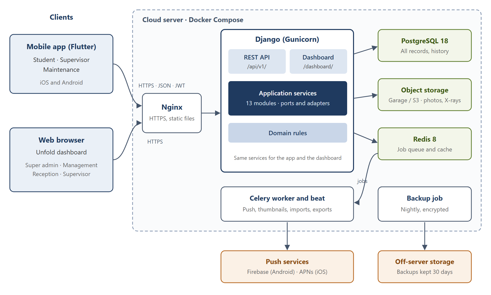
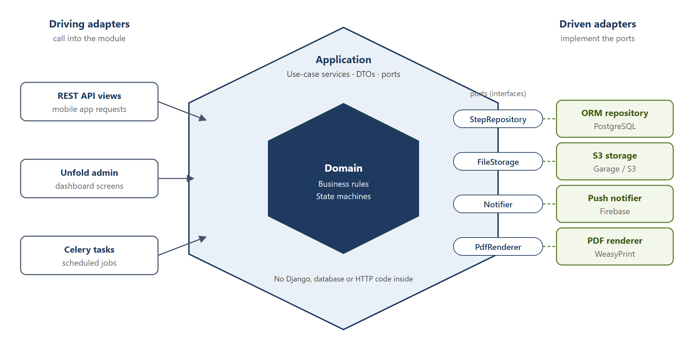
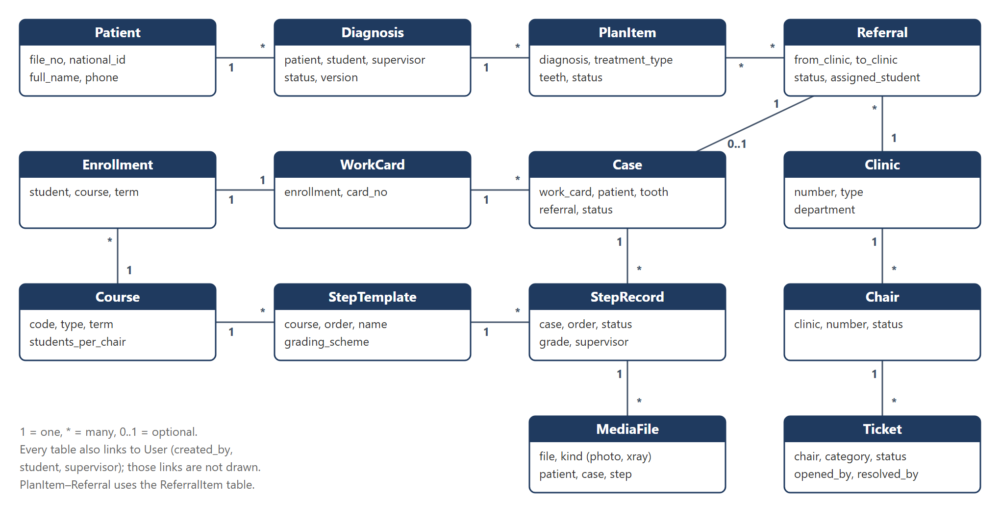

# SPU Dental Clinic System — System Design

Oct 28, 2026 · @Zainab

This document describes how the system is built to meet the Software Requirements Specification: one Django backend with a REST API and an Unfold dashboard, one Flutter app with three role-based interfaces, deployed with Docker on a cloud server.

**Document history**

| Version | Date | Changes |
| --- | --- | --- |
| 1.0 | 26 Oct 2026 | First complete design |
| 1.1 | 28 Oct 2026 | Architecture review: ports and adapters inside the modular monolith, SOLID rules, MVVM in the app; Reception role; supervisors on the dashboard; backend-first build plan in two parallel tracks; diagrams added |
| 1.2 | 29 Oct 2026 | Technology versions checked against current releases: Python 3.13, PostgreSQL 18, Redis 8; Garage replaces MinIO, whose community edition was archived in April 2026; Unfold RTL status updated |

## 1. Design overview and goals

The design keeps the system small enough to build in one month: one backend, one database, one mobile codebase. Every clinic rule lives in configuration tables rather than in code. The backend is a modular monolith: one deployable application, split into modules with strict boundaries, so it can grow with the faculty without the cost of microservices.

**Design goals, in priority order**

1. **Correct clinical records.** Approved records are locked and versioned, every change is audited, and permissions are checked on the server.
2. **Configurable, not coded.** Clinics, chairs, sessions, courses, steps, grading and lists are data the super admin edits (SRS section 4).
3. **Fast at the chair.** Few taps to approve, photos that upload on a weak network, and drafts that survive closing the app.
4. **Easy to change.** Each class has one responsibility, and modules depend on interfaces (ports), not on each other's internals, so a change stays in one place.
5. **Buildable by two people in parallel with Claude Code.** Standard, well-documented libraries; one way of doing each thing; work split into two tracks that do not touch the same files (section 13).
6. **Cheap to run.** A single cloud server with Docker is enough for the expected load (SRS NFR-02).

**Key design decisions**

| Decision | Choice | Why |
| --- | --- | --- |
| Backend shape | One Django project (a modular monolith), split into modules by domain | Simple to deploy and test; clear module boundaries without microservices overhead; a module can later be split out if the faculty needs it |
| Code architecture | Ports and adapters (hexagonal) inside each module, following SOLID; not MVC | Business rules do not depend on Django, the database or outside services, so they are easy to test and to change (section 5) |
| Dashboard | Django Unfold on the Django admin | No separate frontend or API for admin screens; saves about two weeks |
| Mobile | One Flutter app; the role chooses the interface after login; MVVM inside | One store listing, one codebase, shared widgets |
| Workflow | Explicit state machines in a service layer (section 9) | Rules are tested in one place and cannot be bypassed from the API or the dashboard |
| Configuration | Template tables (courses, steps, lists) instead of hard-coded enums | Meets the "everything dynamic" requirement |
| Background work | Celery workers with Redis | Push notifications, thumbnails, Excel imports and PDF exports run without blocking requests |
| Files | S3-compatible object storage behind signed URLs | Patient photos are never public; storage can grow without changing the server |

## 2. System architecture

Two kinds of client reach one server. The Flutter app talks to the REST API, and the browser opens the Unfold dashboard. Both are served by the same Django process and call the same application services.



Django handles each request and hands slow work (push messages, thumbnails, imports, PDF exports) to the Celery worker through Redis. Photos go to private object storage; the database and storage are backed up off the server every night.

## 3. Technology stack

All choices are mature open-source tools with good documentation, which matters when Claude Code writes most of the code. Pin exact versions in the repository when the project starts.

### Backend and dashboard

| Purpose | Library or tool |
| --- | --- |
| Language and framework | Python 3.13, Django 5.2 (LTS, supported until April 2028; upgrade to 6.2 LTS after its April 2027 release) |
| REST API | Django REST Framework |
| Authentication | djangorestframework-simplejwt (access and refresh tokens) |
| API documentation | drf-spectacular (OpenAPI schema and Swagger UI) |
| Filtering and search | django-filter |
| Dashboard | django-unfold (on the Django admin) |
| Excel import and export | django-import-export, openpyxl |
| Change history and versions | django-simple-history |
| File storage | django-storages with boto3 (S3-compatible), Pillow for thumbnails |
| Background jobs | Celery with Redis 8 as the broker (open source under AGPLv3; Valkey is a drop-in alternative); django-celery-beat for scheduled jobs (round reminders, backups) |
| PDF generation | WeasyPrint (HTML templates to PDF, supports Arabic right to left) |
| Push notifications | firebase-admin (FCM for Android, and APNs for iOS through FCM) |
| Database | PostgreSQL 18 (supported until November 2030) |
| Tests | pytest, pytest-django, factory-boy |
| Code quality | ruff (lint and format), mypy (optional) |
| Error tracking | Sentry (free tier) |

### Mobile app

| Purpose | Package |
| --- | --- |
| Framework | Flutter (stable channel), Dart 3 |
| State management | flutter\_riverpod |
| Navigation | go\_router (routes guarded by role) |
| HTTP | dio, with an interceptor that refreshes tokens |
| Models | freezed, json\_serializable |
| Secure token storage | flutter\_secure\_storage |
| Local storage (drafts, upload queue) | drift (SQLite) |
| Photos | image\_picker, flutter\_image\_compress |
| Push | firebase\_messaging, flutter\_local\_notifications |
| Arabic and English | flutter\_localizations, intl (ARB files) |
| Connectivity | connectivity\_plus |
| Tests | flutter\_test, mocktail |

### Infrastructure

| Purpose | Tool |
| --- | --- |
| Containers | Docker, Docker Compose |
| Web server and TLS | Nginx with Let's Encrypt certificates |
| App server | Gunicorn |
| Object storage | Garage (self-hosted, S3-compatible) on the same server, or the hosting provider's S3-compatible storage. MinIO is not used: its community edition was archived in April 2026 and is no longer maintained |
| Code hosting and CI/CD | GitHub, GitHub Actions |
| App builds | Flutter build in CI; uploaded to TestFlight and the Google Play internal track |

## 4. Repository structure

One Git repository holds the backend, the mobile app, the deployment files and the documents, so one Claude Code session can see the whole system.

```
spu-dental/
├── CLAUDE.md                  # conventions for Claude Code (section 13)
├── README.md
├── docs/                      # SRS, this design, API notes, decisions log
├── backend/
│   ├── manage.py
│   ├── pyproject.toml
│   ├── config/                # settings (base, dev, staging, prod), urls, celery, wsgi
│   ├── apps/                  # one folder per module, all with the layout in section 5
│   │   ├── core/              # base models, audit, permissions, shared ports
│   │   ├── accounts/
│   │   ├── setup/             # terms, departments, clinics, chairs, sessions, lookup lists
│   │   ├── academics/         # courses, templates, enrollments, supervisor scope
│   │   ├── patients/
│   │   ├── diagnosis/
│   │   ├── referrals/
│   │   ├── workcards/         # work cards, cases, steps, grading
│   │   ├── media/             # photos and X-rays
│   │   ├── scheduling/        # chair distribution, attendance
│   │   ├── maintenance/       # rounds, tickets
│   │   ├── notifications/
│   │   └── reports/
│   ├── templates/             # PDF and dashboard templates
│   ├── locale/ar/             # Arabic translations
│   └── tests/
├── mobile/
│   ├── pubspec.yaml
│   ├── lib/
│   │   ├── main.dart
│   │   ├── core/              # api client, auth, router, theme, l10n, offline queue
│   │   ├── shared/            # widgets, models used by all roles
│   │   └── features/          # each feature has model/, viewmodel/, view/ (MVVM)
│   │       ├── auth/
│   │       ├── student/       # home, patients, diagnosis, work cards, logbook
│   │       ├── supervisor/    # approvals, referrals, assignment, clinic today
│   │       ├── maintenance/   # rounds, tickets, chairs
│   │       └── notifications/
│   ├── l10n/                  # app_ar.arb, app_en.arb
│   └── test/
├── deploy/
│   ├── docker-compose.yml
│   ├── docker-compose.prod.yml
│   ├── nginx/
│   └── backup/
└── .github/workflows/         # backend tests, mobile build, deploy
```

## 5. Backend modules and architecture

The backend is a modular monolith split into 13 modules (Django apps). Each module owns its tables. Another module reads or changes that data only through the module's application services, never by importing its models.

### Ports and adapters inside each module

Each module follows the ports and adapters (hexagonal) architecture. The business rules sit in the centre and know nothing about Django, the database, HTTP or outside services. They talk to the outside world only through ports, which are small interfaces. Adapters implement those ports, or call into the centre from outside. This is the only architectural pattern used, so every module looks the same.



| Layer | Folder | Holds | May import |
| --- | --- | --- | --- |
| Domain | `domain/` | State machines, business rules (BR-01 to BR-14), value objects such as an FDI tooth number, `DomainError` | Python only |
| Application | `application/` | One service class per use case (for example `ApproveStep`); DTOs (frozen dataclasses) returned to callers; ports defined as `typing.Protocol` interfaces | `domain/` |
| Driving adapters | `api/`, `admin.py` | DRF serializers, views and URLs for the app; Unfold admin screens for the dashboard. They turn a request into a service call | `application/` |
| Driven adapters | `infrastructure/`, `models.py` | Django models and ORM repositories that implement the repository ports; adapters for S3 storage, FCM push, WeasyPrint PDF and Excel | `application/` (to implement its ports) |

`models.py` stays at the root of the module because Django loads models from there. It is treated as part of the persistence adapter: services never import it directly.

**How a request flows.** A DRF view (driving adapter) validates the input and calls `ApproveStep.execute(command)`. The service loads the step through the `StepRepository` port, applies the domain rules, saves it through the same port, and returns a `StepDTO`. The view serializes the DTO. The Unfold dashboard calls the same service, so the app and the dashboard can never apply different rules.

**Dependency injection.** Each module has a `container.py` that builds its services and passes in the concrete adapters through the constructor. Tests pass in-memory fakes of the same ports, so business rules are tested without a database.

**SOLID in practice**

| Principle | How it is applied |
| --- | --- |
| Single responsibility | One service class per use case, one repository per aggregate, one adapter per outside service. A class that does two jobs is split |
| Open / closed | New grading types, notification channels or report formats are added as new adapter or strategy classes, without editing existing ones |
| Liskov substitution | Every adapter fully honours its port, so an in-memory fake, the ORM repository or a future service can replace each other |
| Interface segregation | Ports are small and specific (`StepRepository`, `Notifier`, `FileStorage`, `PdfRenderer`), not one large data-access interface |
| Dependency inversion | Services depend on ports (`Protocol` interfaces); concrete adapters are injected by the module's container |

### Modules

| App | Owns (models) | Main services | SRS |
| --- | --- | --- | --- |
| core | BaseModel (id, created/updated by and at, is\_active), AuditLog | Audit logging, soft delete, shared permission classes, error format | SYS-02, SYS-04, SYS-10 |
| accounts | User, Role, UserRole, DeviceToken | Login, token refresh, account lock, password change, role switch | DB-01, DB-02, DB-20, ST-01, SYS-01 |
| setup | Term, Department, Clinic, Chair, Session, CaseType, ToothCode, MedicalHistoryItem, SoftTissueSite, IndexDefinition, TreatmentType, ChecklistItem, FaultCategory, SystemSetting | Configuration CRUD, default data loaded on install | DB-04, DB-06, DB-18 |
| academics | Course, CourseClinic, CaseRequirement, StepTemplate, GradingScheme, Enrollment, SupervisorScope | Excel import of students and enrollments, eligibility checks, supervisor scope lookup | DB-03, DB-05, DB-07 |
| patients | Patient, PatientAssignment, PatientTransfer, DiagnosisQueueEntry | Registration with duplicate check, file number generation, assignment, transfer | DB-08–DB-11, DB-20, SV-03, SV-09 |
| diagnosis | Diagnosis, MedicalHistoryAnswer, ToothFinding, SoftTissueFinding, IndexScore, PlanItem | Draft, submit, approve, return, version | ST-05, ST-06, SV-04 |
| referrals | Referral, ReferralItem | Create, accept, reject, assign, complete | SV-05, SV-06, SV-08, DB-13 |
| workcards | WorkCard, Case, StepRecord | Card creation on enrollment, case creation (from referral or lab), step submit, approve, return, progress | ST-07–ST-10, SV-07 |
| media | MediaFile | Upload, thumbnail, signed URLs | ST-11, SYS-06 |
| scheduling | ChairAssignment, Attendance | Auto-suggest distribution, attendance | DB-12, SV-11, ST-12 |
| maintenance | Round, ChairCheck, Ticket, TicketEvent | Round submission, ticket workflow, chair status | MT-02–MT-08 |
| notifications | Notification | Create in-app notification, send push, mark read | SYS-03 |
| reports | (no tables; read-only queries) | Daily reports F6/F8/F9/F18, logbook, statistics, Excel and PDF export | DB-15, DB-16, ST-13 |

Read queries that depend on the user (lists, searches, reports) go through query services in `application/` that apply the permission scope (section 8), so the app and the dashboard show each user the same rows.

## 6. Database design

The database is PostgreSQL with about 50 tables. Every table inherits the common fields `id`, `created_at`, `created_by`, `updated_at`, `updated_by` and `is_active`. Clinical tables also keep a full history table via django-simple-history.



A referral becomes exactly one case on the work card of the student it is assigned to, so the patient record and the student's grades stay linked.

### Tables

| App | Table | Key fields | Constraints and indexes |
| --- | --- | --- | --- |
| core | AuditLog | user, action, model, object\_id, changes (JSON), ip, at | Index on (model, object\_id) and on at |
| accounts | User | username, full\_name\_ar, full\_name\_en, phone, university\_id, must\_change\_password, failed\_logins, locked\_until | username unique; university\_id unique when set |
| accounts | Role · UserRole | code (super\_admin, management, reception, supervisor, student, technician) · user, role | (user, role) unique |
| accounts | DeviceToken | user, platform, token, last\_seen | token unique |
| setup | Term | name, start\_date, end\_date, is\_current | One current term |
| setup | Department | name\_ar, name\_en, head (User) | — |
| setup | Clinic · Chair | number, name, building, floor, type (diagnosis, treatment, lab), department · clinic, number, status (in\_service, out\_of\_service) | Clinic number unique; (clinic, number) unique |
| setup | Session | clinic\_type or clinic, name, start\_time, end\_time, order | — |
| setup | CaseType | name\_ar, name\_en, kind (clinical, lab) | — |
| setup | ToothCode | letter, meaning\_ar, meaning\_en, color, order | letter unique |
| setup | MedicalHistoryItem | question\_ar, question\_en, answer\_type (yes\_no, yes\_no\_details, text), is\_alert, order | — |
| setup | SoftTissueSite · IndexDefinition | name, order · kind (calculus, plaque), tooth, surface (buccal, lingual), min\_score, max\_score | — |
| setup | TreatmentType | name\_ar, name\_en, department, case\_type | — |
| setup | ChecklistItem · FaultCategory | name, order · name, blocks\_chair | — |
| setup | SystemSetting | key, value (JSON) | key unique |
| academics | Course | code, name\_ar, name\_en, type (clinical, lab), department, term, students\_per\_chair (1–3), any\_step\_order | (code, term) unique |
| academics | CourseClinic | course, clinic | unique pair |
| academics | CaseRequirement | course, case\_type, required\_count | (course, case\_type) unique |
| academics | GradingScheme | type (numeric, code, pass\_fail), min, max, codes (JSON) | — |
| academics | StepTemplate | course, case\_type (optional), order, name, grading\_scheme, photo\_required | (course, case\_type, order) unique |
| academics | Enrollment | student, course, term | (student, course, term) unique |
| academics | SupervisorScope | supervisor, course (optional), clinic (optional) | At least one of course or clinic |
| patients | Patient | file\_no, national\_id, full\_name, dob, sex, job, phone, address | file\_no unique (generated); national\_id unique when set; index on phone and name |
| patients | DiagnosisQueueEntry | patient, clinic, status (waiting, assigned, done), assigned\_student | One waiting entry per patient |
| patients | PatientAssignment | patient, student, purpose (diagnosis, treatment), case (optional), active, started\_at, ended\_at | Index on (student, active) |
| patients | PatientTransfer | patient, from\_student, to\_student, reason, by, at | — |
| diagnosis | Diagnosis | patient, student, supervisor, clinic, status, chief\_complaint, soft\_tissue\_notes, xray\_findings, diagnosis\_text, version, submitted\_at, approved\_at | One diagnosis in progress per patient (partial unique index) |
| diagnosis | MedicalHistoryAnswer | diagnosis, item, answer, details | (diagnosis, item) unique |
| diagnosis | ToothFinding | diagnosis, tooth (FDI, permanent and primary), code | (diagnosis, tooth, code) unique |
| diagnosis | SoftTissueFinding · IndexScore | diagnosis, site, is\_normal, note · diagnosis, index\_definition, score | Score within the definition's range |
| diagnosis | PlanItem | diagnosis, treatment\_type, teeth (array), department, status (planned, referred, done, cancelled), note | Index on (status, treatment\_type) for the case finder |
| referrals | Referral | from\_clinic, to\_clinic, referred\_by, procedure, note, status, accepted\_by, assigned\_student, reject\_reason, sent\_at, accepted\_at, completed\_at | Index on (to\_clinic, status) |
| referrals | ReferralItem | referral, plan\_item | A plan item in only one open referral (BR-04) |
| workcards | WorkCard | enrollment, card\_no | enrollment unique; card\_no unique per term |
| workcards | Case | work\_card, case\_type, patient, tooth, referral, exercise\_no, status (open, completed, cancelled), completed\_by, completed\_at | referral unique when set |
| workcards | StepRecord | case, template, order, status, student, note, submitted\_at, supervisor, grade\_value, grade\_code, comment, approved\_at | (case, order) unique |
| media | MediaFile | file, thumbnail, kind (photo, xray), uploaded\_by, patient, diagnosis, case, step, ticket, taken\_at, is\_teaching, idempotency\_key | idempotency\_key unique |
| scheduling | ChairAssignment | date, session, chair, course, student | (date, session, chair, student) unique |
| scheduling | Attendance | chair\_assignment, present, marked\_by, marked\_at | chair\_assignment unique |
| maintenance | Round · ChairCheck | clinic, date, kind (morning, afternoon), by, submitted\_at · round, chair, item, ok, note | (clinic, date, kind) unique (BR-11) |
| maintenance | Ticket | chair, category, status, is\_external, description, opened\_by, chair\_check, resolved\_by, resolution, opened\_at, resolved\_at | Index on (status, chair) |
| maintenance | TicketEvent | ticket, from\_status, to\_status, by, note, at | — |
| notifications | Notification | recipient, type, title, body, target, read\_at | Index on (recipient, read\_at) |

## 7. API design

The mobile app uses one REST API under `/api/v1/`. The dashboard does not use the API; it runs inside Django. Workflow changes are explicit action endpoints (for example `/approve/`), never a free edit of a `status` field.

### Conventions

- **Format:** JSON, snake\_case field names, ISO 8601 dates in UTC (shown to users in Damascus time).
- **Authentication:** `Authorization: Bearer <access token>`. The access token lasts 15 minutes and the refresh token 30 days, rotated on each use.
- **Language:** `Accept-Language: ar` or `en` selects the language of error messages and lookup names.
- **Lists:** paginated with `?page=` and `?page_size=` (default 20, maximum 100), filtered with query parameters, and ordered with `?ordering=`.
- **Errors:** HTTP status plus `{"code": "step_out_of_order", "message": "…", "details": {…}}`. The codes are stable so the app can react to them.
- **Actions:** `POST /<resource>/{id}/<action>/` with a small body (for example a grade or a comment). They return the updated object.
- **Idempotency:** uploads and submissions send an `Idempotency-Key` header, so a retry from the offline queue does not create duplicates.
- **Versioning:** `/api/v1/`; breaking changes go to `/api/v2/`.

### Endpoints

| Area | Method and path | Who | Purpose |
| --- | --- | --- | --- |
| Auth | `POST /auth/login/` | All | Username and password → tokens, roles |
| Auth | `POST /auth/refresh/` · `POST /auth/logout/` | All | Refresh token; log out and revoke the token |
| Auth | `GET /me/` · `POST /me/password/` · `POST /me/devices/` | All | Profile and roles; change password; register a push token |
| Lookups | `GET /lookups/` | All | Every lookup list in one call, cached by the app (tooth codes, history items, sites, treatment types, checklist, fault categories, sessions) |
| Patients | `GET /patients/` · `GET /patients/{id}/` | Student (own), Supervisor (scope) | My patients; full record with alerts |
| Diagnosis queue | `GET /diagnosis-queue/` · `POST /diagnosis-queue/{id}/assign/` | Supervisor | Waiting patients; assign one to a student |
| Diagnosis | `POST /diagnoses/` · `GET` · `PATCH /diagnoses/{id}/` | Student | Create, read and edit a draft (all F1 sections in one nested body) |
| Diagnosis | `POST /diagnoses/{id}/submit/` | Student | Send to a supervisor |
| Diagnosis | `POST /diagnoses/{id}/approve/` · `/return/` | Supervisor | Approve, or return with a comment |
| Referrals | `POST /referrals/` | Supervisor | Refer plan items to a clinic |
| Referrals | `GET /referrals/?direction=in\|out&status=` | Supervisor | Inbox and sent list |
| Referrals | `POST /referrals/{id}/accept/` · `/reject/` · `/assign/` | Supervisor | Accept, reject with a reason, assign to a student |
| Referrals | `GET /referrals/{id}/eligible-students/` | Supervisor | Students allowed for this referral, with their progress |
| Work cards | `GET /workcards/` · `GET /workcards/{id}/` | Student (own), Supervisor (scope) | Cards with progress; card detail with cases |
| Cases | `POST /cases/` (lab) · `GET /cases/{id}/` | Student | Create a lab case; case detail with steps |
| Cases | `POST /cases/{id}/complete/` | Supervisor | Confirm the case is complete (closes the referral) |
| Steps | `POST /steps/{id}/submit/` | Student | Mark done with a note and photo ids |
| Steps | `POST /steps/{id}/approve/` · `/return/` | Supervisor | Grade and approve, or return with a comment |
| Approvals | `GET /approvals/` | Supervisor | One queue of waiting diagnoses and steps |
| Transfers | `POST /patients/{id}/transfer/` | Supervisor | Move a patient and open cases to another student |
| Case finder | `GET /case-finder/?treatment_type=&department=` | Supervisor | Patients with approved, not yet referred plan items |
| Media | `POST /media/` (multipart) · `GET /media/{id}/` | Student, Supervisor, Technician | Upload a photo; get a signed link |
| Scheduling | `GET /schedule/?date=` · `GET /clinics/{id}/today/` | Student, Supervisor | My chairs; the clinic's chair × session grid |
| Scheduling | `POST /attendance/` | Supervisor | Mark attendance in bulk |
| Maintenance | `GET /clinics/?with=chair_status` | Technician | Clinics with chair counts |
| Maintenance | `POST /rounds/` | Technician | Submit a round with all chair checks |
| Maintenance | `POST /tickets/` · `GET /tickets/` | Technician, Supervisor | Report a fault; list tickets |
| Maintenance | `POST /tickets/{id}/start/` · `/external/` · `/resolve/` | Technician | Move the ticket through its states |
| Maintenance | `POST /chairs/{id}/status/` | Technician | Set a chair in or out of service, with a reason |
| Notifications | `GET /notifications/` · `POST /notifications/read/` | All | List; mark as read |
| Logbook | `GET /logbook/` | Student | All my cases with grades |

The full request and response schemas are generated by drf-spectacular at `/api/v1/schema/` and browsable at `/api/v1/docs/`. That schema, not this table, is the contract between the backend and the app.

## 8. Security and permissions

Permissions are enforced in three layers on the server: the role allows the action, the scope limits the rows, and the record's state allows the change. The app only hides buttons; it is never trusted.

**1. Role check (per endpoint).** Each view declares the roles allowed, using DRF permission classes such as `IsStudent`, `IsSupervisor`, `IsTechnician`, `IsReception`, `IsSuperAdmin` and `IsManagement`. Each dashboard screen declares its roles in the same way. Roles come from the `UserRole` table. A user with several roles sends `X-Active-Role` to pick the interface; the server checks that the user holds that role.

**2. Scope check (per row).** Every list and detail view reads through a selector that filters the queryset:

- **Student:** patients with an active assignment to them; their own work cards, cases and steps.
- **Supervisor:** clinics and courses in their `SupervisorScope`; diagnoses and steps submitted to those; referrals to and from those clinics. The same scope applies in the app and on the dashboard.
- **Reception:** patient details (name, file number, contact details) and the diagnosis waiting queue; no clinical data such as diagnoses, steps or photos. Dashboard only.
- **Technician:** clinics, chairs, rounds and tickets; no patient data.
- **Management:** read-only, all data, dashboard only.

A record outside the user's scope returns 404, not 403, so its existence is not revealed.

**3. State check (per action).** The service layer refuses transitions that are not allowed from the current state (section 9). The service also enforces business rules BR-01 to BR-14, for example "a supervisor cannot approve their own work".

**Authentication details**

- JWT access tokens last 15 minutes and refresh tokens 30 days, rotated on each refresh. Logout blacklists the refresh token.
- 5 failed logins lock the account for 15 minutes (SYS-01). The super admin can unlock it from the dashboard.
- New accounts get a temporary password, which must be changed on first login.
- Dashboard sessions use Django's session login with CSRF protection and a 2-hour idle timeout. The dashboard is open to the super admin, management, reception and supervisor roles; students and technicians cannot log in to it.

**Data protection**

- HTTPS only, with HSTS enabled.
- Photos are stored in a private bucket and served through signed links that expire after 10 minutes.
- The app keeps photos in its own storage until they are uploaded, then deletes them; nothing goes to the phone's gallery.
- Database and storage backups are encrypted.
- Secrets (database password, JWT key, storage keys, Firebase key) live in environment variables, never in the repository.
- Every create, change, approval, login and failed login goes to `AuditLog`. django-simple-history keeps a full copy of each version of clinical records.
- Rate limiting: login at 10 requests a minute per IP; other endpoints at 120 requests a minute per user.

## 9. Workflow engine

Each workflow record has a `status` field changed only by one application service per action (for example `ApproveStep`). The allowed transitions are defined once in the module's `domain/` state machine. The service checks the guard, writes the change and its side effects in one database transaction, and queues notifications after the commit. The lifecycles are drawn in the SRS (section 6).

**Pattern used by every action**

1. Lock the row (`select_for_update`) and check the current status against the allowed "from" states.
2. Check the guards: role, scope and business rules. If one fails, raise a `DomainError` with a stable code.
3. Update the status and the fields, and write the history record and the audit log entry.
4. Run the side effects, such as updating the plan item, closing the referral or changing the chair status.
5. Call `transaction.on_commit` to queue notifications and push messages in Celery.

### Transition table

| Record | Action | From → to | Who | Guard | Side effects |
| --- | --- | --- | --- | --- | --- |
| Diagnosis | submit | draft, returned → submitted | Student (owner) | Required sections filled; patient assigned to the student | Notify the chosen supervisor |
| Diagnosis | approve | submitted → approved | Supervisor (scope, not owner) | — | Lock the record; plan items become "planned"; notify the student |
| Diagnosis | return | submitted → returned | Supervisor | Comment required | Notify the student |
| Referral | create | → sent | Supervisor | Plan items approved and not in another open referral (BR-04) | Plan items → referred; notify the receiving clinic's supervisors |
| Referral | accept | sent → accepted | Supervisor of receiving clinic | — | Notify the referring supervisor |
| Referral | reject | sent → rejected | Supervisor of receiving clinic | Reason required | Plan items → planned again; notify the referrer |
| Referral | assign | accepted → assigned | Supervisor of receiving clinic | Student eligible (BR-05) | Create the Case on the student's work card with steps from the template; create the PatientAssignment; notify the student |
| Referral | (automatic) | assigned → in treatment | System | First step submitted | — |
| Step | submit | pending, returned → submitted | Student (case owner) | Previous step approved, unless the course allows any order (BR-06); photo present if the template requires one | Notify the supervisors in scope |
| Step | approve | submitted → approved | Supervisor (scope, not owner) | Grade valid for the course's grading scheme | Lock the step; notify the student |
| Step | return | submitted → returned | Supervisor | Comment required | Notify the student |
| Case | complete | open → completed | Supervisor | All steps approved | Referral → completed; plan item → done; work card progress +1; notify the referring clinic (BR-08) |
| Ticket | open | → open | Technician, Supervisor, System (failed check) | — | If the category blocks the chair: chair → out of service; notify the technicians |
| Ticket | start | open → in progress | Technician | — | — |
| Ticket | external | in progress → external repair | Technician | Note required | — |
| Ticket | resolve | in progress, external repair → resolved | Technician | Repair note required | Chair → in service if no other blocking ticket; notify whoever reported it |

### Notifications

One `Notification` row per recipient and event holds the type, a title and body in the recipient's language, a link to the target (for example `case:123`), and a read time. A Celery task sends the push message. If push fails, the row stays and the app shows it in the list (SYS-03).

### Scheduled jobs (Celery beat)

| Job | When | What |
| --- | --- | --- |
| Round reminder | 9:30 and 15:00 | Notify technicians of clinics with no round submitted (MT-09) |
| Stale referral alert | Daily 8:00 | Notify the receiving supervisors of referrals waiting more than 3 days (configurable) |
| Clean expired tokens | Nightly | Remove blacklisted tokens |
| Backup | Nightly 2:00 | Dump the database and copy storage to the backup location |

## 10. Mobile app design

One Flutter app opens one of three interfaces after login. Each interface is a separate feature folder with its own bottom navigation, and all three share the API client, the offline queue, the theme and the common widgets. Supervisors also have the web dashboard (section 11); students and technicians use only the app.

### App architecture (MVVM)

The app follows Model–View–ViewModel, the usual pattern for Flutter. Each feature folder has `model/`, `viewmodel/` and `view/`.

- **View:** screens and widgets. They only draw the state of their ViewModel and pass user actions to it. They never call the API.
- **ViewModel:** a Riverpod `Notifier` per screen or feature. It holds the screen state (loading, data, error), calls the repositories, and exposes actions such as `approve()`. It has no Flutter widget code, so it is unit-tested on its own.
- **Model:** freezed data classes and repositories per resource (for example `CaseRepository`). Repositories call the API through dio and map JSON to the models. They are abstract classes with one implementation, so ViewModels can be tested with fakes.
- **Local:** a drift (SQLite) database with three tables: diagnosis drafts, the upload queue and the cached lookups.
- **Core:** the dio client with a token refresh interceptor, go\_router with role guards, the theme (Arabic font, right-to-left), localization, error mapping from API codes to messages, and the connectivity watcher.

### Visual identity

The screens are designed after the backend and its API are complete (section 13). The design uses the SPU visual identity: the university and Faculty of Dentistry logos and the university colours. The same colours are applied to the Unfold dashboard theme, so the app and the dashboard look like one product.

### Login and role routing

1. Log in, and receive tokens and roles. Tokens are stored in secure storage.
2. A first login forces a password change.
3. A user with one role goes straight to its home. A user with several roles picks one, and can switch later from the profile.
4. go\_router guards the role prefixes `/student/…`, `/supervisor/…` and `/maintenance/…`. A wrong role is sent back to its own home.

### Working on a weak network

- **Drafts:** the diagnosis form saves to local storage on every change and syncs to the server draft when online.
- **Uploads:** each photo is compressed to at most 2 MB and put in the upload queue with an idempotency key. A background worker sends it, and retries with back-off.
- **Submissions:** a step is sent for approval only after all its photos have uploaded. Until then the screen shows "waiting to upload".
- **Lookups:** cached and refreshed at most once a day, or when the server's version number changes.

### Screens

| Interface | Bottom tabs | Screens |
| --- | --- | --- |
| Student | Home · Patients · Work cards · Notifications · Profile | Home (today's clinic, chair and sessions; returned items; waiting items) · My patients · Patient record (alerts banner, diagnoses, plan, referrals, photos) · Diagnosis wizard: 1 Complaint, 2 Medical history, 3 Dental chart, 4 Soft tissue, 5 Indices, 6 X-rays, 7 Diagnosis and plan, 8 Review and submit · Work cards list · Work card (progress per case type) · Case (steps) · Step submit (note, camera, gallery) · New lab case · My schedule · Logbook |
| Supervisor | Approvals · Referrals · Clinic today · Notifications · Profile | Home and approvals queue (diagnoses and steps, filter by clinic) · Diagnosis review (all sections read-only, approve or return) · Step review (photos full screen, grade input by scheme, approve or return) · Create referral (select plan items, clinic, note) · Referral inbox and sent list · Assign student (eligible list with progress) · Diagnosis queue · Transfer patient · Case finder · Clinic today (chair × session grid, attendance) · Student progress · Report fault |
| Maintenance | Clinics · Tickets · Notifications · Profile | Clinics list (chairs in and out of service) · Round (morning or afternoon; one row per chair; "all OK"; fault entry with photo) · Ticket list (open, by age) · Ticket detail (start, external, resolve, notes, photos) · Chair detail (status, history, set in or out of service) |

### Key widgets

- **Dental chart:** a 4 × 8 grid in FDI order (18→11 | 21→28 on top, 48→41 | 31→38 below). Tapping a tooth opens a sheet of code chips, multi-select. The colours and letters come from the lookup.
- **Soft tissue map:** a list of sites with a normal or finding toggle and a note field. The oral illustration from F1 is shown as a reference image.
- **Index entry:** the six configured teeth and surfaces, each with a 0–3 segmented control, and the computed index shown live.
- **Grade input:** built from the course's grading scheme as a number pad, a code chip list or a pass / fail toggle.
- **Patient alert banner:** a red banner listing the alert items, shown on every patient screen.

Detailed wireframes for these screens are a separate deliverable of the design phase.

## 11. Web dashboard design

The dashboard is the Django admin styled with Unfold, at `/dashboard/`. Standard admin pages cover the setup screens. A few custom Unfold pages cover the boards and reports, and all of them call the same services as the API.

### Sidebar

| Group | Items | Type |
| --- | --- | --- |
| Home | Key figures: patients, open referrals, approvals waiting, chairs out of service | Custom page with Unfold cards and charts |
| Patients | Patients (register, search, edit, history) · Diagnosis queue | Admin with inlines; "Send to diagnosis clinic" action |
| Clinical | Referral board · Diagnoses (read-only) · Work cards and cases (read-only) | Custom board; read-only admin |
| Scheduling | Chair distribution planner · Attendance | Custom page: chair × session grid with auto-suggest |
| Maintenance | Chair status board · Tickets · Rounds | Custom board; admin with filters |
| Academic setup | Terms · Courses (inlines: case requirements, step templates, clinics, supervisors) · Grading schemes · Enrollments · Import students (Excel) | Admin with inlines; import-export |
| Facilities | Departments · Clinics (inline chairs) · Sessions | Admin with inlines |
| Lists | Tooth codes · Medical history items · Soft tissue sites · Index definitions · Treatment types · Checklist items · Fault categories | Admin with sortable order |
| Reports | Daily clinic (F8) · Daily lab (F9) · Chair status (F6/F18) · Student logbook · Course progress · Pending treatments · Referral and maintenance statistics | Custom pages with filters; Excel and PDF export |
| Users | Users · Roles · Audit log | Admin; audit log read-only |
| Settings | System settings | Single-record admin |

**What each role sees.** One dashboard serves four roles. Each role sees only its own sidebar groups, and the server checks the role on every screen and action (section 8).

| Role | Sidebar groups | Can change |
| --- | --- | --- |
| Super admin | All | Everything |
| Management | Home, Patients (read-only), Clinical, Scheduling, Maintenance, Reports | Nothing; every screen is read-only (`has_change_permission` returns false) |
| Reception | Patients (register, search, edit details) · Diagnosis queue (send a patient, see today's queue) | Patient details and queue entries only; no clinical data is shown |
| Supervisor | Home (own clinics) · Approvals · Clinical (referral board for own clinics) · Scheduling (distribution and attendance for own clinics) · Students (progress in own courses) · Reports (own clinics and courses) · Maintenance (report a fault) | The same actions as in the Supervisor interface of the app, limited to their scope |

**Arabic layout:** Django's `LANGUAGES` setting with Arabic as the default, and `dir="rtl"` on the dashboard's base template. Unfold merged a series of right-to-left fixes in September and October 2026 (sidebar, header, filters, actions); RTL is still checked in phase 0, and the fallback is Flutter Web (Project Plan, risks).

## 12. Deployment, environments and CI/CD

The whole backend runs as Docker Compose services on one cloud Linux server. A server with 4 vCPU, 8 GB RAM and about 200 GB of disk covers the expected load and several years of photos; storage can move to managed S3 later without code changes.

### Environments

| Environment | Where | Purpose | Data |
| --- | --- | --- | --- |
| Development | Each developer's laptop (Docker Compose) | Building and unit tests | Seed data from a fixture script |
| Staging | Same cloud server, separate containers and database, `staging.<domain>` | Thursday demos, store review builds, user acceptance test | Realistic fake patients; never real data |
| Production | Cloud server, `dental.<spu domain>` | Live use | Real data, backed up nightly |

### Production services (docker-compose.prod.yml)

| Service | Image | Role |
| --- | --- | --- |
| nginx | nginx | HTTPS (Let's Encrypt), static files, upload size limit, proxy to the web container |
| web | backend image | Gunicorn running Django: the API and the dashboard |
| worker | backend image | Celery worker: push, thumbnails, imports, PDF and Excel exports |
| beat | backend image | Celery beat: scheduled jobs (section 9) |
| db | postgres:18 | Database, on a persistent volume |
| redis | redis:8 | Celery broker and cache |
| storage | garage | S3-compatible photo storage, on a persistent volume (or the provider's S3) |
| backup | small cron image | Nightly encrypted database dump and storage copy to off-server storage, kept 30 days |

### CI/CD with GitHub Actions

| Workflow | Trigger | Steps |
| --- | --- | --- |
| backend-ci | Every pull request | Lint with ruff; run pytest against a PostgreSQL service; check that migrations are complete; check that the OpenAPI schema builds |
| mobile-ci | Every pull request touching `mobile/` | flutter analyze; flutter test |
| deploy-staging | Merge to `main` | Build and push the backend image; SSH to the server; `docker compose pull && up -d`; run migrations |
| deploy-production | Tag `v*` | Same as staging, against production, after manual approval |
| mobile-release | Tag `app-v*` | Build the Android App Bundle and the iOS archive; upload to the Google Play internal track and TestFlight |

**Monitoring:** Sentry for backend and app errors, a free uptime check on `/health/`, and a disk-space alert at 80%.

**Store publishing:** developer accounts held outside Syria (Project Plan). Reviewers get demo logins for each role on staging data. A privacy policy page is served at `/privacy/`.

## 13. Build plan and development conventions

### Build order

The system is built backend first. The whole backend, its API and the dashboard are finished and tested before the mobile screens are built, so the app is written once against a stable API instead of being changed after every backend change. This order is also the fastest with AI-assisted development.

| Phase | Dates | Work | Done when |
| --- | --- | --- | --- |
| 0. Contracts | 21–22 Nov | Repository, Docker setup, `core` and `accounts` modules, the ports of every module, and the OpenAPI schema outline. Both developers together | Both tracks can start without waiting for each other |
| 1. Backend | 22–27 Nov | All 13 modules: domain rules, services, adapters, API and dashboard screens. Two parallel tracks (below) | Every Must requirement passes its API tests; the dashboard works in Arabic |
| 2. Frontend | 28–29 Nov | Visual design from the SPU identity; the three mobile interfaces built against the finished API. Two parallel tracks | Every screen in section 10 works against staging |
| 3. Integration | 30 Nov | End-to-end tests of each user story on staging; fixes | All 24 user stories pass on staging |
| 4. Hardening | 1–25 Dec | Should and Could requirements, reports and PDF exports, performance, store builds, Thursday demos to the clinic | Ready for the user acceptance test on 26 Dec |

The later dates (acceptance test, production deployment, training and handover on 18 Jan 2027) stay as in the Project Plan. Phase 4 is the buffer that protects the handover date.

### Two parallel tracks

The work is split so the two developers never edit the same files. The ports agreed in phase 0 are the contract between the tracks: a track that needs another module calls its port, using a fake until the real adapter is ready.

| Track | Phase 1 — Backend modules | Phase 2 — Mobile |
| --- | --- | --- |
| A — Clinical flow | patients, diagnosis, referrals, workcards, media | Student interface; shared app core (API client, login, offline queue) |
| B — Operations | setup, academics, scheduling, maintenance, notifications, reports; dashboard theme and role menus | Supervisor and Maintenance interfaces |

Each track works on its own branches and pull requests. The other developer reviews each pull request before it is merged.

### Conventions for Claude Code

These rules go into `CLAUDE.md` at the root of the repository, so every Claude Code session follows the same structure. Each build prompt names the user stories (US-xx) and requirement IDs it implements.

**Backend rules**

- Every module follows the layout in section 5: `domain/`, `application/`, `infrastructure/`, `api/`, `admin.py`, `models.py`, `container.py`. Ports and adapters is the only architectural pattern; do not add others.
- Every model inherits `core.BaseModel`. Records are never hard-deleted; use `is_active=False`.
- Business rules and status changes live only in `domain/` and in the application services. Views, serializers, models and admin actions contain no business logic; they call a service.
- One class, one responsibility: one service per use case, one repository per aggregate, one adapter per outside service.
- Services receive their ports through the constructor (built in `container.py`) and return DTOs (frozen dataclasses), never Django model instances.
- A module never imports another module's `models.py` or `infrastructure/`; it calls that module's application services.
- Reads that depend on the user go through query services that apply the scope filter (section 8).
- Errors: raise `DomainError(code, message)`; one exception handler turns it into the API error format.
- Every user-facing string is wrapped in `gettext`, with Arabic in `locale/ar`.
- Every service gets pytest tests for the allowed path, each guard failure, and the permission scope, using in-memory fakes of its ports. Repositories get separate tests against PostgreSQL.
- Migrations are committed. Migrations are never edited after they are merged.

**Mobile rules**

- Feature-first folders (`features/<role>/<feature>/`), each with `model/`, `viewmodel/` and `view/` (MVVM).
- No API calls or business logic in widgets; views read their ViewModel only, and ViewModels reach the API only through repositories.
- Every text comes from the ARB files in Arabic and English. No hard-coded strings.
- Use `EdgeInsetsDirectional` and `AlignmentDirectional` everywhere, so right-to-left layout works.
- API error codes are mapped to localized messages in one place.
- After changing the API, regenerate the models from the OpenAPI schema or update the freezed models to match it.

**Process rules**

- Work is split into small tasks, one per user story or module, never the whole project in one step. One branch and one pull request per task. The pull request description lists the US and requirement IDs and how they were tested.
- Before merging, a developer reviews the diff, runs it on staging, and checks it in Arabic.
- `docs/decisions.md` records every decision that changes this design, with its date and reason.

**Prompt template for a story**

```
Implement US-07 (SV-07, SYS-03) from docs/SRS.md, backend only.
Scope: workcards module. Domain: step state machine (approve/return).
Application: ApproveStep and ReturnStep services, StepDTO, StepRepository port.
Adapters: ORM repository, DRF endpoints, Unfold action.
Follow CLAUDE.md. Acceptance criteria: <paste from SRS>.
Add tests for each criterion. Do not touch other modules.
```

## 14. Traceability

Every SRS requirement maps to at least one backend module and one interface, and each module belongs to one track (section 13).

| SRS requirements | Backend module(s) | Interface | Track |
| --- | --- | --- | --- |
| DB-01, DB-02, ST-01, SV-01, MT-01, SYS-01, SYS-02 | accounts, core | All | Both (phase 0) |
| DB-03, DB-05, DB-07 | academics | Dashboard | B |
| DB-04, DB-06, DB-18, SYS-07, SYS-09, SYS-10 | setup, core | Dashboard | B |
| ST-07–ST-11, SV-07, SYS-06 | workcards, media | Student, Supervisor | A |
| DB-08–DB-11, DB-20, ST-03, ST-04, SV-03 | patients | Dashboard, Student, Supervisor | A |
| ST-05, ST-06, SV-04, SYS-05 | diagnosis | Student, Supervisor | A |
| SV-05, SV-06, SV-08, DB-13 | referrals, workcards | Supervisor, Dashboard | A |
| SV-09, SV-10 | patients, diagnosis | Supervisor | A |
| DB-12, SV-11, ST-12 | scheduling | Dashboard, Supervisor, Student | B |
| MT-02–MT-08, SV-13, DB-14 | maintenance | Maintenance, Supervisor, Dashboard | B |
| SYS-03, ST-14, SV-14, MT-09 | notifications | All | B |
| DB-15, DB-16, DB-17, ST-13, SV-12, SYS-08 | reports, core | Dashboard, Student, Supervisor | B |
| DB-21 | accounts, all modules' dashboard screens | Dashboard | B |
| SYS-04 | core (AuditLog, simple-history) | Dashboard | Both (phase 0) |
